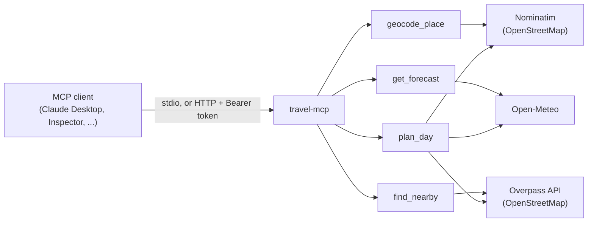

# travel-mcp

An [MCP](https://modelcontextprotocol.io) server for trip planning that runs on **open data only** – no API keys required.
It gives an AI assistant four tools: look up a place, get its weather forecast, find places nearby, and put it all together into a **weather-aware day plan**.



## Tools

| Tool | What it does | Source |
| --- | --- | --- |
| `geocode_place` | Place name or address → coordinates | Nominatim |
| `get_forecast` | Daily forecast (conditions, min/max temperature, precipitation, wind) for 1–16 days | Open-Meteo |
| `find_nearby` | Named museums, parks, restaurants, cafes, viewpoints and attractions around a point, sorted by distance | Overpass |
| `plan_day` | Geocodes a place, checks the forecast for a date and suggests outdoor stops on good days and indoor stops (museums, cafes) when rain, strong wind or extreme temperatures are expected | all of the above |

`plan_day` treats a day as unsuitable for outdoor plans when precipitation probability is ≥ 50 %, precipitation is ≥ 2 mm, wind is ≥ 40 km/h, or the maximum temperature is below 5 °C or above 35 °C. The reasons are returned together with the plan so the assistant can explain its suggestion.

## Quick start

Requires Node.js ≥ 22.18.

```bash
git clone https://github.com/zelaplagg/travel-mcp.git
cd travel-mcp
npm install
npm run build
```

### Use with Claude Desktop (stdio)

Add this to your Claude Desktop config (`claude_desktop_config.json`) and restart the app:

```json
{
  "mcpServers": {
    "travel": {
      "command": "node",
      "args": ["/absolute/path/to/travel-mcp/dist/index.js"]
    }
  }
}
```

Set `TRAVEL_MCP_USER_AGENT` in the `env` block to identify yourself to Nominatim (see [Data sources](#data-sources-and-fair-use)).

### Run as an HTTP server

HTTP mode uses the MCP Streamable HTTP transport in stateless mode and requires a bearer token.

```bash
export TRAVEL_MCP_TOKEN=$(openssl rand -hex 32)
npm run start:http          # listens on 127.0.0.1:3000

curl http://127.0.0.1:3000/health
```

The MCP endpoint is `POST /mcp` with `Authorization: Bearer <token>`. Requests are rate limited per client address (`RATE_LIMIT_PER_MINUTE`, default 60). Behind a reverse proxy the client address is the proxy's address, so rate limit there as well.

### Docker

```bash
docker build -t travel-mcp .
docker run --rm -p 3000:3000 -e TRAVEL_MCP_TOKEN=$(openssl rand -hex 32) travel-mcp
```

### Try it with the MCP Inspector

```bash
npx @modelcontextprotocol/inspector node dist/index.js
```

## Configuration

| Variable | Default | Purpose |
| --- | --- | --- |
| `TRAVEL_MCP_TOKEN` | – | Required in HTTP mode, at least 16 characters |
| `HOST` / `PORT` | `127.0.0.1` / `3000` | HTTP bind address |
| `RATE_LIMIT_PER_MINUTE` | `60` | Per-client request limit in HTTP mode |
| `TRAVEL_MCP_USER_AGENT` | `travel-mcp/0.1.0 (...)` | Sent to upstream APIs; set it to your own contact or repository URL |
| `NOMINATIM_URL`, `OPEN_METEO_URL`, `OVERPASS_URL` | public instances | Point to self-hosted instances if you need more throughput |

## Design notes

- **Thin MCP layer, testable core.** `src/server.ts` only declares tools and validates input with zod. Everything else – API clients, the day-planning logic, rate limiting, caching, auth – lives in plain modules that receive their dependencies as arguments and are tested without network access or the MCP SDK.
- **Polite to upstream services.** Nominatim calls are spaced at least 1.1 s apart and results are cached for an hour; forecasts are cached for 10 minutes. Failed requests are retried once on network errors, HTTP 429 and 5xx, never on other 4xx.
- **Safe by construction.** Overpass queries are built only from numbers and a fixed table of tags, never from user text. Tool errors are mapped to short messages, so upstream hostnames and stack traces are not exposed to the client. Tokens are compared in constant time.
- **Stateless HTTP.** A new server and transport are created per request, so no state is shared between clients.

## Security notes

- **OpenStreetMap text is untrusted.** Names, addresses and websites come from data anyone can edit and end up in the model's context, so they are a prompt-injection channel. Before they reach a tool result, `src/lib/sanitize.ts` removes control, zero-width, bidi-override and Unicode tag characters (a way to hide text), caps lengths and drops websites that are not plain `http(s)` URLs. This does **not** stop instructions written in ordinary visible words, so clients and models must still treat tool output as data. [`mcp-audit eval`](https://github.com/zelaplagg/mcp-audit) measures how well a model resists that; see its README.
- **Audited with its own tooling.** `mcp-audit scan -- node dist/index.js` ([mcp-audit](https://github.com/zelaplagg/mcp-audit)) reports no findings for this server. That checks what the server advertises (descriptions, schemas, annotations), not what its code does.
- **No user text in queries.** The Overpass query is built only from numbers and a fixed category table.
- **HTTP mode is authenticated and rate limited** (bearer token, per-IP limits), and the server calls only the three public APIs listed below.

## Development

```bash
npm run typecheck   # tsc, including tests
npm test            # node:test, runs the TypeScript tests directly
npm run build       # emits dist/
npm run dev         # run src/index.ts directly (stdio)
```

The tests run on Node's built-in test runner with TypeScript type stripping, so they need no extra tooling. External APIs are replaced by a fake `fetch`.

## Data sources and fair use

- Geocoding and places: © [OpenStreetMap](https://www.openstreetmap.org/copyright) contributors, ODbL. Use of the public Nominatim and Overpass instances is subject to their usage policies: identify your application, keep request rates low and cache results. For heavy use, run your own instances.
- Weather: [Open-Meteo](https://open-meteo.com/), whose free API is intended for non-commercial use and requires attribution (CC BY 4.0).

## License

MIT
